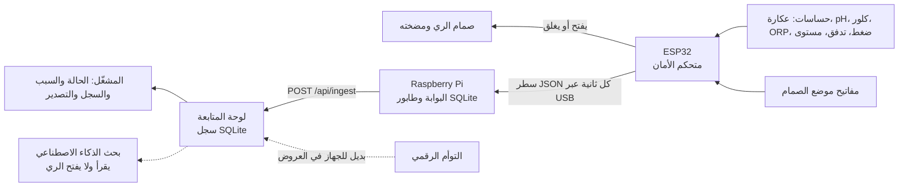

<div dir="rtl">

# البنية التقنية



القرار يُتخذ في ESP32 وحده. البوابة واللوحة تنقلان البيانات وتعرضانها ولا ترسلان أوامر. لو تعطل Raspberry Pi أو الشبكة يستمر المتحكم في الحماية.

## المستودع

| المجلد | ما فيه | التقنية |
|---|---|---|
| `core/`&lrm; | قواعد الأمان: الحدود والحالات المشتركة وتنفيذ Python وJS | Python، JS |
| `twin/`&lrm; | التوأم الرقمي: خزانان 5000 لتر، تدفق 1000 لتر/ساعة، ستة أعطال | Python، ونسخة JS للمتصفح |
| `dashboard/`&lrm; | خادم اللوحة والسجل والواجهة العربية | Python (المكتبة القياسية)، SQLite |
| `gateway/`&lrm; | البوابة على Raspberry Pi | Python (المكتبة القياسية) |
| `firmware/esp32/`&lrm; | برنامج متحكم الأمان | C++، Arduino، PlatformIO |
| `web/`&lrm; | موقع الشركة: رحلة لتر واحد بالتمرير، وغرفة تحكم حية مع موك أب الجوال، بالعربية والإنجليزية | Vite، Three.js، postprocessing، camera-controls، GSAP، Lenis |
| `research/`&lrm; | كشف الشذوذ (V8) | numpy، pandas، scikit-learn |
| `brand/`&lrm; | الهوية: الرموز والشعارات والأيقونات والخطوط | CSS، SVG |

## التوأم الرقمي

يحاكي `twin/plant.py` وحدة واحدة: يصل ماء الوضوء إلى خزان الخام، وتنقله مضخة التغذية عبر المعالجة إلى الخزان المعالج، ثم يذهب إلى الري إذا سمح المتحكم. عند الاحتجاز تستمر المعالجة ويمتلئ الخزان المعالج، والري متوقف. القراءات إشارات توضيحية، لا نموذج كيمياء. ميزان الماء يُفحص في كل خطوة.

الأعطال الستة للاختبار: ارتفاع العكارة، وفقد قراءة الكلور، وانسداد المرشح، وانقطاع الكهرباء، وتعطل صمام الري مغلقًا، والتشغيل الاعتيادي.

&rlm;`twin/trace.json` سيناريو ثابت يجب أن يعيد إنتاجه التوأمان (Python وJS) حرفيًا. بعد أي تعديل مقصود على التوأم: `python -m twin.plant --write-trace`.

## الرسائل بين الأجزاء

&rlm;ESP32 يطبع سطرًا كل ثانية:

```json
{"device":"wareva-proto-1","boot":"1a2b3c4d","seq":42,
 "readings":{"turbidity":0.71,"ph":7.2,"chlorine":0.35,"orp":681,"p1":2.8,"p2":2.55,"treated_level_percent":40,"flow_lpm":16.6},
 "decision":{"state":"REUSE","valve_command":"open","valve_feedback":"open","reasons":[],"latched":[]},
 "irrigated_l":120.5}
```

البوابة تحفظ كل سطر في طابورها أولًا، ثم ترسله إلى اللوحة بمعرّف `device:boot:seq`. إذا ضاع الرد وأُعيد الإرسال، تعيد اللوحة نفس رقم القراءة ولا تسجلها مرتين.

## التشغيل

```sh
python -m dashboard.server                      # اللوحة على http://127.0.0.1:8787 بالتوأم الرقمي
python -m gateway.gateway --serial /dev/ttyUSB0 # على Raspberry Pi مع الجهاز
npm install && npm run dev                      # الموقع والتجربة على http://127.0.0.1:4173
```

اللوحة تعمل على `127.0.0.1` افتراضيًا. &lrm;`--host 0.0.0.0` لشبكة محلية موثوقة فقط، لأنها بلا تسجيل دخول.

## الاختبارات

```sh
python -m unittest discover -s . -p "test_*.py"   # core وtwin وdashboard وgateway
npm test                                         # core/decide.js وtwin/plant.js
python -m core.gen_rules_h --check               # ملفات المتحكم مطابقة لـ rules.json
g++ -std=c++17 -Ifirmware/esp32/include -Ifirmware/esp32/test firmware/esp32/test/test_safety.cpp -o test_safety && ./test_safety
```

اختبارات البحث منفصلة لأنها تحتاج مكتبات علمية: انظر [research/README.md](../research/README.md). كل هذه الاختبارات تفحص البرمجيات، ولا تثبت جودة ماء أو أداء جهاز.

</div>
